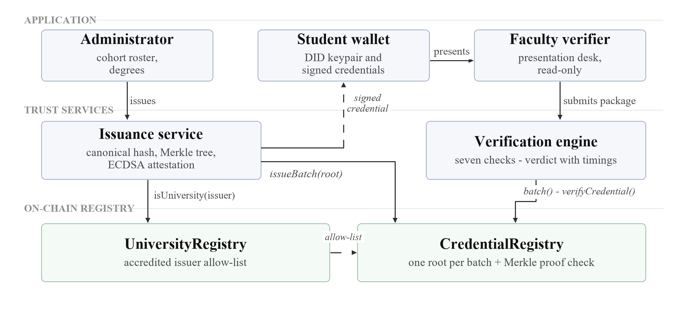
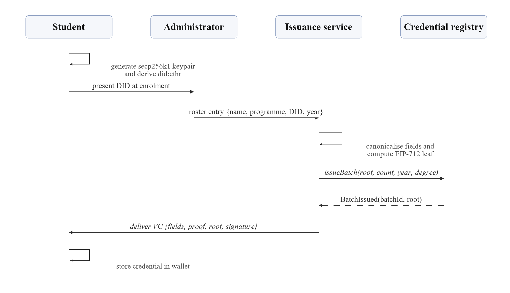
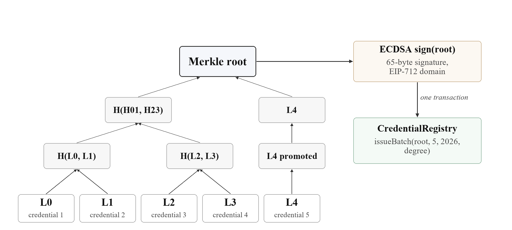
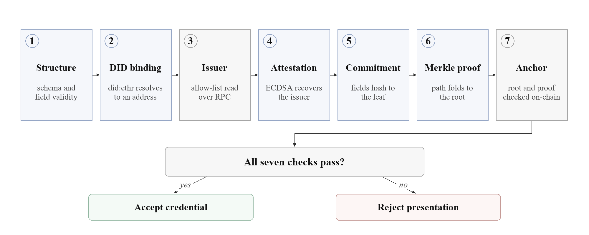
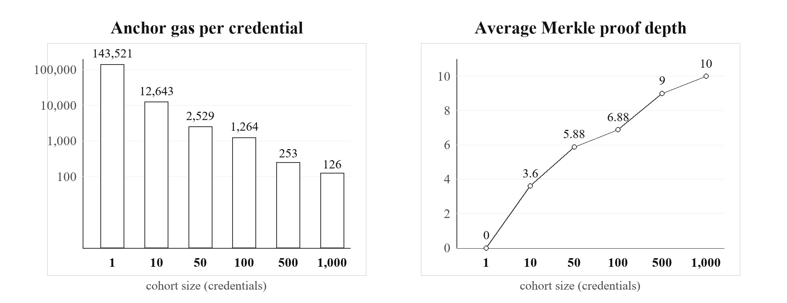
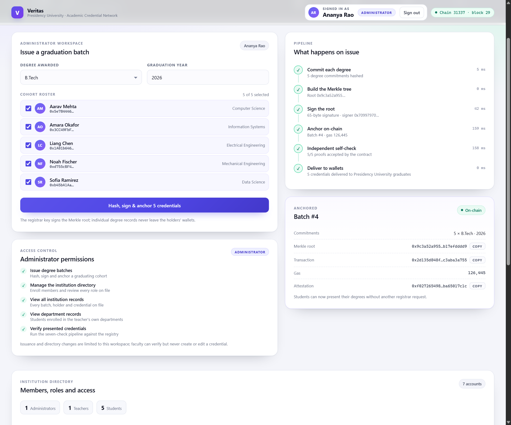
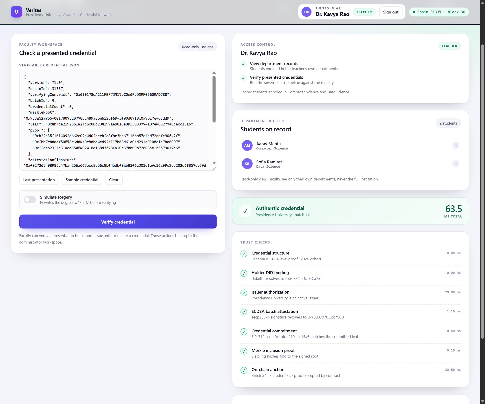
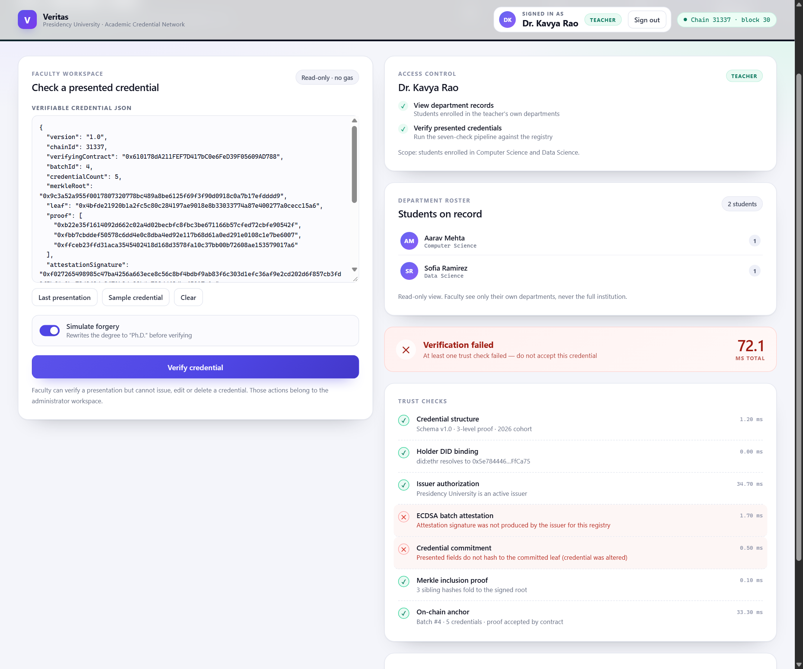

# Abstract

Academic credential verification is still a largely manual process. Employers contact registrars, wait for confirmations, or commission background checks, even when the underlying award is already recorded in an institutional database. The delay is not caused by missing information but by the absence of a portable, verifiable proof that the holder can present directly. This report presents **Veritas**, a decentralized academic credential and skill verification system that replaces institutional callbacks with a cryptographic proof that anyone can check.

Veritas binds each credential to a self-sovereign decentralized identifier (DID) derived from the student's own keypair. A university canonicalises every degree into an EIP-712 commitment, combines the commitments of an entire graduating class into a sorted-pair Merkle tree, signs the root with ECDSA using domain-separated typed data, and anchors the root in a single transaction on an Ethereum-compatible registry. To apply for a position, a student hands over only the credential fields, the Merkle path, the signed root and the issuer attestation. The verifier recomputes the commitment locally, checks the issuer against an on-chain allow-list, folds the Merkle path to the attested root, and confirms the root through a read-only contract call.

The system is implemented with Solidity, Hardhat, TypeScript and React. Seven integration tests cover issuance, proof verification, issuer authorization, replay resistance, tamper detection and issuer deactivation. Benchmarks from 1 to 1,000 credentials show that the anchoring cost is effectively constant at about 126,000 gas, that a 1,000-credential cohort needs a ten-hash proof, and that verification completes well below one second. A forged presentation is rejected at the attestation and commitment checks. The results show that cryptographic batch attestation can remove the manual verification bottleneck while keeping student data off the ledger.

# 1. Introduction

## 1.1 Background

Every university produces a large volume of academic records each year. Degrees, transcripts and skill certificates are issued through internal systems, printed or exported as documents, and later verified by employers, licensing bodies and other institutions. The verification step has changed little: a third party contacts the registrar, an officer searches the student record, and a confirmation is returned by email or letter. The process is slow, expensive and difficult to scale.

Public-key cryptography has long offered a better primitive. If an institution signs a statement with its private key, anyone holding the corresponding public key can verify the statement without contacting the institution. The obstacle is not the signature itself but the surrounding infrastructure: which key belongs to which institution, how a graduate carries the signed statement, and how an institution can attest thousands of awards without publishing each one individually.

Distributed ledgers provide a shared, tamper-evident registry for trust anchors and revocation data. A university can publish the root of a batch of credentials on-chain, and an employer can verify a single credential against that root using a short Merkle proof. The ledger stores no personal data; it stores only a 32-byte commitment and a small amount of cohort metadata [1], [2], [3].

## 1.2 Motivation

The motivation for this work comes from three observations.

First, verification latency is dominated by coordination rather than computation. The cryptographic checks require milliseconds, but the human workflow requires days because it depends on the availability of a registrar and the responsiveness of an institution.

Second, digital documents are easy to alter. A scanned certificate or a PDF with a letterhead is not self-authenticating. Employers therefore fall back to manual checks or paid screening services, which reintroduces delay and cost.

Third, existing blockchain credential proposals often store one record per credential. This makes the ledger a public directory of awards and makes issuance cost grow linearly with the number of graduates. A scalable design should write a constant-size commitment per cohort and reveal individual records only when the holder chooses to present them.

## 1.3 Problem Statement

The problem addressed in this project is to design and implement a credential-verification system in which a university can issue a large cohort of tamper-evident credentials with one on-chain transaction, a graduate can hold and present a credential without depending on the university, and an employer can verify the credential in seconds without contacting the issuer and without disclosing the rest of the cohort.

## 1.4 Proposed Solution

Veritas combines a decentralized identifier layer, a typed-data credential commitment, a Merkle batch attestation and two small smart contracts.

The student generates a secp256k1 keypair and derives a `did:ethr` identifier from the corresponding address. The university includes the DID in the credential, hashes the credential fields with EIP-712, builds a Merkle tree over the cohort, signs the root with ECDSA, and anchors the root on-chain. The issued presentation package contains the credential fields, the leaf, the Merkle path, the root, the attestation signature and the anchor transaction. The verifier runs seven checks and produces a verdict, paying no gas and making no contact with the university.

## 1.5 Scope of the Project

The project delivers a complete reference implementation: Solidity contracts, a deployment and evaluation suite, a shared TypeScript cryptographic library, and a React application with three role-scoped workspaces for the administrator, the teacher and the student, each enforcing the permissions of its institutional role. The evaluation uses a local Ethereum development chain, Presidency University as the registered issuer and a five-student sample cohort. Production concerns such as hardware key custody, public-network deployment, per-credential revocation and selective disclosure are discussed as future work in Chapter 9.

## 1.6 Organisation of the Report

Chapter 2 surveys related work and Chapter 3 identifies the research gaps. Chapter 4 presents the methodology, Chapter 5 states the objectives, and Chapter 6 describes the design and implementation. Chapter 7 reports the outcomes, Chapter 8 presents the results, and Chapter 9 concludes the report and outlines future work.

# 2. Literature Survey

## 2.1 Traditional Verification and Public-Key Infrastructure

Classical public-key infrastructures bind identities to keys through certificates issued by trusted authorities. A digital signature over a credential would allow a verifier to check integrity and origin, and this principle underlies standards such as the Digital Signature Standard [9]. In practice, however, academic institutions rarely expose a verification key or a signed statement that a graduate can carry. The verifier instead relies on the institution's operational authority, which brings the coordination delay described in Chapter 1.

## 2.2 Blockchain-Based Academic Credentials

Blockchain-based credential systems place a trust anchor in a shared ledger. Blockcerts defines an open standard for blockchain-anchored certificates in which a document is hashed and the hash is registered on a blockchain [8]. EduCTX proposes a blockchain-based higher-education credit platform with a distributed ledger of credit transfers [7]. These systems demonstrate tamper evidence and issuer independence, but they often register one transaction per credential or per document. The resulting cost and the amount of public metadata grow with the number of awards.

## 2.3 Merkle Trees and Batch Attestation

Merkle trees, introduced by Merkle [3], allow a large set of values to be committed to a single root such that membership of any value can be proven with a logarithmic-size path. The root is the only value that needs to be signed or stored. Blockchain systems use the same construction to commit to transaction sets [1]. Applied to credentials, a Merkle root can represent an entire graduating class while each student receives only a short path. Verification requires the path and the signed root, not the cohort.

## 2.4 Decentralized Identifiers and Verifiable Credentials

The W3C Decentralized Identifiers specification defines identifiers that are created and controlled by the subject rather than assigned by a registry [4]. The W3C Verifiable Credentials Data Model defines a portable format for cryptographically verifiable claims, together with a presentation model in which the holder discloses selected credentials to a verifier [5]. Veritas follows the same trust model: the issuer signs, the holder presents, and the verifier checks. The DID is used as the holder identifier, and a presentation package plays the role of the verifiable presentation.

## 2.5 Smart Contracts and Typed-Data Signatures

Ethereum introduced a general-purpose virtual machine for executing smart contracts [2], [12]. Smart contracts provide a transparent allow-list of accredited issuers and a permanent, auditable record of anchored roots. EIP-712 defines a structured, human-readable typed-data hashing scheme and a domain separator that binds a signature to a chain and a verifying contract [6]. This prevents a valid signature for one registry or one network from being replayed in another context. The reference implementation uses the OpenZeppelin `MerkleProof` library, which verifies sorted-pair proofs compatible with standard tooling [10].

## 2.6 Summary of Existing Approaches

**Table 2.1: Comparison of credential-verification approaches**

| Approach | How verification works | Strengths | Limitations |
| --- | --- | --- | --- |
| Paper certificates and registrar letters | A human checks the record with the issuer | Familiar and simple | Days to weeks; scans are forgeable; manual |
| Centralised digital diploma platforms | The vendor database is queried | Fast for participating institutions | Single point of trust; issuer lock-in |
| Per-credential blockchain registries | One transaction and one record per credential | Transparent and tamper-evident | Cost and public metadata grow linearly |
| Verifiable-credential standards | The issuer signs a portable credential | Interoperable and privacy-friendly | Requires a trust registry and revocation strategy |
| Veritas (this project) | Typed commitment plus Merkle proof against an anchored root | Constant on-chain cost; short proofs; no issuer contact | Requires an available chain and an allow-list; revocation pending |

The comparison shows that the proposed system occupies a useful position: it keeps the portability and holder control of verifiable-credential standards while using a Merkle batch to obtain the constant on-chain cost of a commitment scheme.

# 3. Research Gaps of Existing Methods

## 3.1 Verification Latency and Manual Coordination

Most institutions still verify awards through a human workflow. The cryptographic tools exist, but the signed statement is not handed to the graduate in a form that an employer can check. The gap is a presentation protocol that is complete enough for a verifier and minimal enough for the holder.

## 3.2 Scalability of Per-Credential Anchoring

Systems that write one record per credential make issuance cost proportional to the size of the graduating class. They also publish a continuously growing directory of awards. A scalable design should anchor a fixed-size commitment per cohort and keep individual records off-chain.

## 3.3 Privacy and Data Minimisation

Public registries that store names, identifiers or grades create a permanent disclosure risk. The verification process should reveal only the credential being presented, not the rest of the cohort and not the identity of the verifier. This calls for commitments and inclusion proofs rather than plaintext records.

## 3.4 Issuer Accreditation

A signature is only meaningful if the verifier knows which keys belong to accredited institutions. Existing academic systems often rely on institutional reputation or vendor contracts. A transparent, auditable allow-list maintained by a governance authority provides a stronger and programmable trust anchor.

## 3.5 Revocation, Holder Binding and Key Custody

Revocation, proof of possession and key custody remain open problems in many designs. The reference implementation addresses revocation at the issuer level, binds the credential to the holder DID, and documents holder proof-of-possession and per-credential revocation as future work. Recognising these gaps explicitly keeps the evaluation honest and defines a clear extension path.

## 3.6 Gaps Addressed in This Project

The project addresses the first four gaps directly: it provides a complete presentation protocol, constant-cost batch anchoring, data minimisation through Merkle proofs, and an on-chain issuer allow-list. It also demonstrates a tamper-evident commitment that makes field-level alteration detectable. The remaining gaps are scoped as future work.

# 4. Proposed Methodology

## 4.1 Design Principles

The design follows five principles:

1. **Holder control.** The student owns the keypair and the credential. The university does not need to be online when the credential is presented.
2. **Minimal on-chain state.** Only a root and small cohort metadata are written to the ledger.
3. **Local recomputation.** The verifier recomputes every hash and every proof instead of trusting fields supplied in the presentation.
4. **Domain separation.** Signatures are bound to a chain and a registry address to prevent replay.
5. **Explicit trust anchors.** Issuers are admitted through an on-chain allow-list, and historical batches remain verifiable after deactivation.

## 4.2 System Overview

The system has three off-chain roles and two on-chain contracts. The administrator, representing the registrar's office, collects student DIDs and produces a roster. The issuance service canonicalises each credential, builds the Merkle tree, signs the root and submits one transaction. The student wallet stores the resulting presentation package. The teacher verifier runs the seven checks against the package and the chain, and an external employer runs the same pipeline against the same artefacts. The `UniversityRegistry` contract maintains the issuer allow-list, and the `CredentialRegistry` contract stores batch roots and verifies Merkle proofs.

## 4.3 Identity Layer

A holder identity is a `did:ethr` identifier derived from a secp256k1 public key. The identifier has the form `did:ethr:0x<address>`, where the address is the last 20 bytes of the keccak-256 hash of the public key. Creating the identifier requires no transaction. The university receives the DID at enrolment, includes it in the credential commitment, and therefore binds the award to the holder's keypair. A verifier resolves the DID by extracting the address and checking the binding in the credential.

## 4.4 Credential Commitment

Each credential contains seven fields: issuer address, holder DID, student name, degree type, field of study, graduation year and credential identifier. The fields are hashed with EIP-712 under the domain `AcademicCredential v1`. Typed-data hashing gives a deterministic encoding, avoids ambiguous concatenation, and produces a 32-byte leaf that commits to every field. Changing any field changes the leaf.

## 4.5 Batch Construction and Attestation

The leaves of a cohort are combined into a sorted-pair Merkle tree. At each level, adjacent nodes are ordered lexicographically before hashing, and an unpaired node is promoted to the next level unchanged. This construction is compatible with the OpenZeppelin verifier. The root is signed with the issuer's ECDSA key using EIP-712 typed data over `{merkleRoot, credentialCount, degreeType, graduationYear}`. The domain binds the chain ID and the registry address, so the signature cannot be replayed on another network or contract.

The anchoring procedure is:

```
leaves   = [credentialLeaf(c) for c in cohort]
tree     = buildMerkleTree(leaves)          # sorted-pair keccak256
root     = tree.root
sig      = ecdsa_sign(attestation(root, count, degree, year))
tx       = credentialRegistry.issueBatch(root, count, year, degree)
package  = {fields, leaf, proof, root, sig, tx}
```

The on-chain transaction is independent of cohort size: it stores one root and a small metadata struct.

## 4.6 Presentation and Verification

A presentation contains the credential fields, the leaf, the Merkle path, the root, the attestation signature, the batch identifier and the anchor transaction hash. The verifier runs seven checks: schema validity, DID binding, issuer authorization, ECDSA attestation, credential commitment, Merkle inclusion and the on-chain anchor. The first six checks can be evaluated locally except for the issuer lookup; the final check reads the batch root and asks the contract to verify the proof. Any failed check rejects the presentation.

## 4.7 Cryptographic Components

**Table 4.1: Cryptographic components and their purpose**

| Component | Construction | Purpose |
| --- | --- | --- |
| Holder identifier | `did:ethr` from a secp256k1 address | Self-sovereign identity bound to a keypair |
| Credential leaf | EIP-712 hash of seven fields | Commits to every credential field |
| Merkle tree | Sorted-pair keccak-256 with odd-node promotion | Cohort commitment with short membership proofs |
| Attestation | ECDSA over EIP-712 batch data | Proves issuer authorship and binds the root |
| Domain separator | Chain ID and registry address | Prevents cross-chain and cross-contract replay |
| Presentation | Leaf, path, root, signature and transaction | Complete package for independent verification |

## 4.8 Technology Stack

**Table 4.2: Implementation technology stack**

| Layer | Technology | Role |
| --- | --- | --- |
| Smart contracts | Solidity 0.8.24 and OpenZeppelin 5 | Issuer registry, batch anchoring and proof verification |
| Development and testing | Hardhat 2.22, ethers v6 and TypeScript | Compilation, tests, deployment and benchmarks |
| Shared cryptography | TypeScript modules | Merkle tree, EIP-712 commitments and verification pipeline |
| User interface | React 18, Vite 5 and TypeScript | Role-scoped administrator, teacher and student workspaces |
| Reference network | Hardhat EVM, chain ID 31337 | Local deployment and reproducible evaluation |

## 4.9 Development Process

The work followed an incremental process: requirements and threat analysis, contract and cryptographic design, implementation of the shared library, contract tests, a benchmark harness, and finally the React interface and end-to-end evaluation. Each stage produced executable evidence, so the design claims in this report are backed by the same code that runs in the application.

# 5. Objectives

## 5.1 Primary Objective

To design and implement a decentralized academic credential verification system in which a university can issue tamper-evident credentials to a cohort with one on-chain transaction and a verifier — a teacher or an employer — can check a presented credential in seconds without contacting the university.

## 5.2 Specific Objectives

1. Provide a self-sovereign holder identity based on a decentralized identifier.
2. Commit each credential to a typed-data hash that covers every disclosed field.
3. Issue a cohort through a single Merkle root and a single anchor transaction.
4. Sign the root with ECDSA and bind the signature to the chain and registry.
5. Verify a credential with a short Merkle proof and read-only contract calls.
6. Enforce issuer accreditation through an on-chain allow-list.
7. Detect forged or altered presentations and report the failing check.
8. Keep personal data off the ledger and reveal only the presented credential.
9. Evaluate correctness, cost and latency with reproducible tests and benchmarks.

## 5.3 Measurable Targets

The project targets a constant on-chain cost per cohort, logarithmic proof size, sub-second verification, zero verifier gas cost, and a clean rejection of tampered credentials. Chapter 7 maps each target to the evidence obtained, and Chapter 8 reports the measurements.

# 6. System Design and Implementation

## 6.1 Requirements

**Table 6.1: Functional and non-functional requirements**

| ID | Requirement | Design response |
| --- | --- | --- |
| FR-1 | A university can issue degree credentials to students | Signed credential package delivered to the holder wallet |
| FR-2 | A student controls identity and credentials | Holder-generated keypair and `did:ethr` identifier |
| FR-3 | Large cohorts can be issued economically | One Merkle root anchored per cohort |
| FR-4 | A verifier can verify without contacting the issuer | Local checks plus two read-only contract calls |
| FR-5 | Verification reveals only the presented credential | Merkle inclusion proof instead of a cohort list |
| FR-6 | Only accredited institutions can issue | Owner-managed on-chain allow-list |
| FR-7 | Alterations must be detectable | EIP-712 commitment and ECDSA attestation |
| FR-8 | An issuer can be deactivated without erasing history | Historical batches remain verifiable |
| FR-9 | Access follows institutional roles | Administrator, teacher and student accounts with distinct permissions |
| NFR-1 | Verification completes in seconds | Local hashing plus two `eth_call` requests |
| NFR-2 | Personal data remains off-chain | Only root, count, year and degree type are stored |
| NFR-3 | Signatures cannot be replayed across chains | EIP-712 domain binds chain ID and registry |
| NFR-4 | The system is reproducible | Hardhat tests, scripts and documented commands |
| NFR-5 | The interface is usable by non-specialists | Three guided workspaces with enforced role permissions |
| NFR-6 | Verification is free | Read-only calls; no transaction is sent |

## 6.2 Architecture

The architecture separates the off-chain issuance and presentation path from the on-chain trust anchors.



The administrator and the issuance service prepare the cohort. The student wallet stores the presentation package and hands it to a teacher or an employer. The verification engine reads the issuer allow-list from `UniversityRegistry` and the batch root from `CredentialRegistry`. The only values written on-chain are the Merkle root and the cohort metadata; the credential fields, the holder DID and the proofs remain off-chain.

## 6.3 Identity and Credential Data Model

A credential is represented as a JSON object with the following fields: issuer address, holder DID, student name, degree type, field of study, graduation year and credential identifier. The presentation wraps the credential with the protocol version, chain ID, verifying contract, batch ID, credential count, Merkle root, leaf, proof, attestation signature, issuance timestamp and transaction hash. This package is self-contained: a verifier needs no additional lookup beyond the chain.

The degree catalogue covers the awards offered by the institution, including B.Tech, B.E., B.Sc., BBA, B.Com., BCA, M.Tech, M.Sc., MBA, MCA and Ph.D. The administrator selects one award per batch, and the award is part of the signed attestation, so a batch of management degrees cannot be presented as an engineering cohort.

## 6.4 DID Issuance Workflow

The DID workflow is shown in Figure 6.2. The student generates a keypair and derives the identifier locally. The DID is presented to the administrator at enrolment or graduation. The administrator adds the DID to the roster, and the issuance service canonicalises the fields, builds the tree, signs the root and anchors the batch. The credential package is returned to the student wallet. No transaction is required to create the DID; the first on-chain write is the cohort anchor.



## 6.5 Batch Issuance Workflow

Figure 6.3 illustrates batch issuance for a five-credential cohort. Each credential becomes a leaf. Pairs are combined into parent hashes; the unpaired fifth leaf is promoted; the final root is signed and anchored. For a cohort of n credentials, the tree has ceil(log2 n) levels, the proof for any credential contains at most ceil(log2 n) sibling hashes, and the on-chain cost is constant.



The batch submitted to the registry contains the issuer address, the Merkle root, the number of credentials, the issuance timestamp, the graduation year and the degree type. The issuer is taken from the transaction sender and must be an active university.

**Table 6.2: On-chain batch data model**

| Field | Type | Description |
| --- | --- | --- |
| issuer | address | Account that anchored the batch |
| merkleRoot | bytes32 | Root of the sorted-pair credential tree |
| credentialCount | uint32 | Number of credentials committed by the root |
| issuedAt | uint64 | Block timestamp of the anchor |
| graduationYear | uint16 | Graduation cohort year |
| degreeType | string | Award associated with the cohort |

## 6.6 Smart Contract Design

The `UniversityRegistry` contract is owned by a governance account and stores an allow-list of accredited issuers with a display name and an active flag. The owner can register an issuer, deactivate or reactivate it, and query its status and name. Deactivation affects only new batches.

The `CredentialRegistry` contract stores one `Batch` struct per issuance and exposes `issueBatch`, `batch`, `batchCount` and `verifyCredential`. `issueBatch` requires the caller to be an active university. `verifyCredential` reconstructs the root from the leaf and proof using the OpenZeppelin `MerkleProof` library and compares it with the stored root. The contract emits a `BatchIssued` event containing the batch ID, issuer, root and credential count, which the scripts use to build the presentation packages.

## 6.7 Verification Protocol

The verification protocol consists of seven checks, shown in Figure 6.4.



**Table 6.3: Verification checks and failure conditions**

| # | Check | Failure condition | Execution |
| --- | --- | --- | --- |
| 1 | Credential structure | Missing or malformed fields, invalid hash length | Local |
| 2 | DID binding | The DID does not resolve to a valid address | Local |
| 3 | Issuer authorization | The issuer is not an active university | Contract read |
| 4 | ECDSA attestation | The signature does not recover to the issuer or the domain differs | Local |
| 5 | Credential commitment | The presented fields do not hash to the leaf | Local |
| 6 | Merkle inclusion | The path does not fold to the signed root | Local |
| 7 | On-chain anchor | The batch root, issuer or proof is rejected by the contract | Contract read |

The commitment and attestation checks are deliberately redundant. The Merkle proof demonstrates that the leaf belongs to the batch, while the commitment and attestation demonstrate that the presented fields are the ones the issuer signed. A forged credential can reuse a genuine leaf and proof, as the evaluation shows, but it cannot produce fields that match the committed leaf or the attested degree type and year.

## 6.8 Security and Threat Model

**Table 6.4: Threat model and mitigations**

| Threat | Mitigation | Residual risk |
| --- | --- | --- |
| Field alteration in the JSON | EIP-712 commitment and attestation cover the fields | None if the checks are run correctly |
| Proof reuse from another credential | The leaf is bound to all fields and the proof is root-specific | Negligible |
| Signature replay on another chain or registry | EIP-712 domain includes chain ID and verifying contract | None |
| Fabricated issuer signature | Recovered signer must equal the allow-listed issuer | Issuer key compromise |
| Issuance by an unaccredited institution | `issueBatch` reverts for non-universities | Governance compromise |
| Stolen holder key | The credential is bound to the DID, but presentation does not yet require possession | Holder-side risk; proof of possession is future work |
| Malicious RPC endpoint | The verifier can use multiple providers; proofs are checked locally | Availability and censorship |
| Privacy leakage through the ledger | Only roots and cohort metadata are stored | Cohort-level metadata is public |

## 6.9 Implementation

The repository is organised into five areas. `contracts/` contains the two Solidity contracts. `shared/` contains the Merkle tree, the EIP-712 credential and attestation logic, the verification pipeline and the shared TypeScript types. `scripts/` contains deployment, cohort seeding, benchmarking and live verification. `test/` contains the Hardhat integration suite. `web/` contains the React application. The same shared modules run in the scripts and in the browser, so the tests and the interface exercise identical cryptography.

The application separates users into three institutional roles. The administrator workspace belongs to the registrar's office. It issues degree batches, manages the institution directory and the role matrix, reads every batch and credential on file, and can verify a presentation. The teacher workspace is scoped to the departments that a faculty member teaches. It lists the students enrolled in those departments and provides the verification desk, but it cannot issue, edit or delete a credential. The student workspace shows only the signed-in holder's DID, certificate, proof path and presentation package, with one action that hands the presentation to a teacher for verification.

Accounts are created in the interface rather than provisioned in advance. The sign-in screen offers two tabs: sign in with an existing username and password, or create an account by choosing a role and completing the fields that role requires. A teacher selects a title and at least one department from the catalogue, a student selects a field of study, and an administrator joins the registrar's office. Registration derives a salted PBKDF2-SHA-256 hash (150,000 iterations, 32-byte output) with the Web Crypto API and stores only the hash, never the password. Each new student or teacher receives a fresh `did:ethr` address from a generated key pair, while an administrator account binds to the institution's accredited issuer key so that the credentials it signs pass the issuer-authorization check. A session is persisted locally, the top bar always shows the signed-in name and role, and signing out returns to the sign-in screen. The registrar can also enroll members from the directory, so a department can be populated before the first sign-in.


Figure 6.6 shows the same screen in registration mode with the teacher role selected. The form adapts to the chosen role: a teacher picks a title and the departments they teach, a student picks a field of study, and an administrator is told that the account will represent the registrar's office. The submit button and the closing hint repeat the selected role, so the consequence of the choice is explicit before the account is created.


**Table 6.5: Role permission matrix**

| Capability | Administrator | Teacher | Student |
| --- | --- | --- | --- |
| Issue a degree batch | Granted | — | — |
| Manage the institution directory | Granted | — | — |
| View all institution records | Granted | — | — |
| View students in own departments | Granted | Granted | — |
| Verify a presented credential | Granted | Granted | — |
| Hold and present own credentials | — | — | Granted |

The same matrix is rendered in the administrator directory and as an access card in every workspace, so the permission boundary is visible rather than implied by the interface. The boundary also holds for failure paths: a teacher who edits the degree fields inside a presentation cannot re-sign the batch, because the attestation key belongs to the administrator's account.

## 6.10 Deployment

Deployment uses Hardhat [11] against a local node: the deploy script publishes both contracts, registers the administrator's account as Presidency University, and writes the addresses, ABIs and contract roles to a configuration file. It does not create user accounts — administrators, teachers and students register through the interface, and the registrar enrolls additional members from the directory. The seeding script anchors a five-student B.Tech sample cohort so that the verification desk and the benchmarking scripts have a valid presentation to work with. The evaluation commands are `npm run chain`, `npm run setup` and `npm run dev`.

# 7. Outcomes

## 7.1 Functional Outcomes

The implemented system satisfies the functional requirements. A university can issue a cohort through a guided pipeline and a single transaction. Each student receives a wallet entry with a DID, a certificate, a proof path and a presentation package. A teacher or an employer can paste the package, run the verification and obtain a verdict. The issuer allow-list rejects unaccredited issuers, and deactivating an issuer blocks new batches while leaving historical credentials verifiable. Access follows the institutional role: only the administrator can issue a batch or read every record, teachers are limited to their own departments and read-only verification, and students can only present their own credentials. Accounts are self-service across all three roles, with password hashing at rest, session persistence and a visible sign-out on every screen.

## 7.2 Non-Functional Outcomes

The non-functional targets are also met. Verification is local except for two contract reads and completes in well under one second on the reference machine. Personal data remains off-chain. Signatures are domain-separated by chain and registry. The tests, scripts and interface are reproducible from documented commands. The verifier pays no gas.

## 7.3 Requirement Traceability

**Table 7.1: Requirement traceability**

| Requirement | Implementation | Evidence |
| --- | --- | --- |
| FR-1 Issue credentials | Issuance service, `issueBatch`, wallet delivery | Figure 8.2, seed output |
| FR-2 Holder control | `did:ethr`, local wallet, presentation package | Figure 8.3 |
| FR-3 Cohort-scale issuance | Merkle tree and single anchor transaction | Table 8.2 |
| FR-4 No issuer contact | Seven-check verifier with contract reads | Figure 8.4 |
| FR-5 Minimal disclosure | Merkle proof only | Figure 8.4 |
| FR-6 Accreditation | `UniversityRegistry` allow-list | Test 3 |
| FR-7 Tamper evidence | Commitment and attestation | Table 8.3, Figure 8.5 |
| FR-8 Deactivation | Active flag checked at issuance | Test 7 |
| FR-9 Role-based access | Self-registered accounts, role-scoped workspaces and permission matrix | Table 6.5, Figures 8.2 to 8.5 |
| NFR-1 Seconds | 63.5 ms total in the interface | Figure 8.4 |
| NFR-2 Off-chain data | Batch struct contains no personal data | Table 6.2 |
| NFR-3 Replay resistance | EIP-712 domain separation | Test 6 |
| NFR-4 Reproducibility | Hardhat tests, scripts and report figures | Chapter 8 |
| NFR-5 Usability | Three guided role workspaces | Figures 8.2 to 8.5 |
| NFR-6 Free verification | Read-only calls | Figure 8.4 |

# 8. Results and Discussions

## 8.1 Experimental Setup

All measurements were taken on a Windows 11 laptop running Node.js, a local Hardhat node with chain ID 31337, and the React interface in a headless Chromium browser. Presidency University was the registered issuer. Accounts were created through the sign-in screen exactly as an institution would use them: one administrator in the registrar's office, one teacher responsible for Computer Science and Data Science, and five students across the five departments. The evaluation cohort therefore contained five students. Benchmarks deployed fresh contracts on an in-process Hardhat network to isolate contract execution from network latency. The interface measurements include real HTTP JSON-RPC calls to the local node [13].

## 8.2 Correctness and Security Tests

The Hardhat suite contains seven integration tests. All tests pass.

**Table 8.1: Integration test results**

| Test | Guarantee | Result |
| --- | --- | --- |
| Owner-only university registration | Only governance can admit an issuer | Pass |
| Anchor and verify every credential | Every leaf in a batch verifies on-chain | Pass |
| Reject unregistered issuers | `issueBatch` reverts for non-universities | Pass |
| Reject cross-batch proofs | A proof cannot be replayed against another root | Pass |
| Reject altered credentials | Changed fields break the proof | Pass |
| Bind attestation to issuer and registry | Signature recovers to the issuer and the domain matches | Pass |
| Deactivation preserves history | New batches are blocked, old batches remain valid | Pass |

## 8.3 Issuance and Verification Performance

Table 8.2 reports the benchmark results for cohorts of 1 to 1,000 credentials.

**Table 8.2: Benchmark results**

| Credentials | Batch preparation (ms) | Average proof depth | Proof generation (ms) | Off-chain verification (ms) | On-chain verification (ms) | Anchor gas |
| ---: | ---: | ---: | ---: | ---: | ---: | ---: |
| 1 | 6.64 | 0 | 0.14 | 0.09 | 4.99 | 143,521 |
| 10 | 17.24 | 3.6 | 0.01 | 0.48 | 3.51 | 126,433 |
| 50 | 62.40 | 5.88 | 0.01 | 0.53 | 2.97 | 126,433 |
| 100 | 116.52 | 6.88 | 0.01 | 0.57 | 2.83 | 126,433 |
| 500 | 548.59 | 9 | 0.01 | 0.78 | 2.73 | 126,445 |
| 1,000 | 1,069.36 | 10 | 0.01 | 0.79 | 3.02 | 126,445 |



Three results stand out. First, the anchor gas is effectively constant: the first batch costs 143,521 gas because it initialises cold storage, while subsequent batches cost about 126,440 gas regardless of cohort size. At 1,000 credentials this is approximately 126 gas per graduate. Second, the proof depth grows logarithmically and reaches ten hashes at 1,000 credentials. Third, verification remains constant-time from the verifier's perspective: two contract reads plus a small amount of local hashing.

Batch preparation grows linearly with cohort size, reaching about 1.07 seconds for 1,000 credentials in TypeScript. This is an off-chain cost paid once per cohort and is negligible compared with the latency of the manual process it replaces.

## 8.4 End-to-End Application Results

Figure 8.2 shows the administrator workspace issuing a new B.Tech cohort, anchored as batch 4 during the evaluation. The registrar signed in with an account created on the sign-in screen. The workspace selects the award from the degree catalogue, fixes the graduation year, and draws the cohort from the five students who registered accounts beforehand. The pipeline reports six stages: commitment hashing, tree construction, root signing, anchoring, an independent five-of-five self-check and wallet delivery. The receipt shows the final root, the transaction hash, the gas used and the attestation signature, while the access card states the administrator's permissions.



Figure 8.3 shows the student workspace after the holder signs in as Aarav Mehta with the credentials created at registration. The wallet displays the DID, a B.Tech certificate for the 2026 cohort and the presentation package with the committed leaf, batch root, root attestation, anchor transaction and proof path. The access card lists the single student capability, presenting own credentials, and the presentation action hands the package to a teacher without exposing the rest of the graduating class. The package is the credential issued in batch 4 to this holder, and the header shows that the student holds one credential from four anchored batches.


Figure 8.4 shows the teacher workspace after the presented credential was verified. The faculty view is restricted to the departments the teacher teaches, so Dr. Kavya Rao sees only the two students enrolled in Computer Science and Data Science, with a read-only roster and no issuance controls. The verdict is "Authentic credential" for batch 4 issued by Presidency University, and all seven checks pass in 63.5 ms, including two HTTP JSON-RPC reads.



A separate command-line run against the same node measured 289.5 ms for a valid credential in a cold Node.js process. The difference is attributable to process startup, first-use cryptographic initialisation and HTTP overhead; both runs are well below the one-second target.

## 8.5 Tamper Detection

Figure 8.5 shows the same presentation after the forgery switch changed the degree to a doctoral award. The verdict is "Verification failed". The attestation and commitment checks fail, while the Merkle proof and the on-chain anchor still pass because the attacker reused a genuine leaf and proof. The run completed in 72.1 ms. This is the intended behaviour: possession of a valid proof is not sufficient, and a teacher cannot repair the presentation because only the administrator holds the attestation key.



**Table 8.3: Verification of a valid and a forged presentation**

| Check | Valid credential | Forged credential |
| --- | --- | --- |
| Credential structure | Pass, 0.80 ms | Pass, 1.20 ms |
| Holder DID binding | Pass, 0.00 ms | Pass, 0.00 ms |
| Issuer authorization | Pass, 29.90 ms | Pass, 34.70 ms |
| ECDSA batch attestation | Pass, 1.10 ms | Fail, 1.70 ms |
| Credential commitment | Pass, 0.40 ms | Fail, 0.50 ms |
| Merkle inclusion proof | Pass, 0.10 ms | Pass, 0.10 ms |
| On-chain anchor | Pass, 30.50 ms | Pass, 33.30 ms |
| Verdict | Authentic, 63.5 ms | Rejected, 72.1 ms |

## 8.6 Cost Analysis

The anchoring cost is one transaction per cohort. At an illustrative gas price of 20 gwei and an Ether price of USD 3,000, a 1,000-credential batch costs approximately 0.00253 ETH, or USD 7.60, which is less than one cent per graduate. Verification costs the verifier nothing because it uses read-only calls. The dominant cost in a production deployment would be the governance and infrastructure of running an accredited issuer, not the per-credential anchoring.

## 8.7 Comparison with Conventional Verification

**Table 8.4: Conventional verification compared with Veritas**

| Dimension | Conventional process | Veritas |
| --- | --- | --- |
| Latency | Days to weeks | 72 ms measured in the interface |
| Issuer involvement at verification | Required | None |
| Integrity evidence | Letterhead, seals, human checks | EIP-712 commitment, ECDSA, Merkle proof |
| Privacy | The verifier learns the request context | Only the presented credential is disclosed |
| Cost per check | Staff time or agency fee | Zero gas; one RPC read pair |
| Scalability | Linear in staff effort | Constant on-chain cost per cohort |
| Revocation | Re-issue or manual list | Issuer deactivation plus future per-credential status |

## 8.8 Discussion and Threats to Validity

The measurements were taken on a local development chain. Public-network latency and gas prices will differ, but the algorithmic properties (constant storage, logarithmic proof size and local verification) are independent of the network. The issuer is a local deployment of Presidency University and the keys are development keys; production deployments require hardware-backed key custody and governance. The prototype does not implement per-credential revocation or holder proof of possession, so it should be read as a complete verification architecture with a documented extension path rather than a production-ready service.

The tests and benchmarks use deterministic inputs and are reproducible. Reported timings vary with machine load, which is why the report presents both the in-process benchmarks and the end-to-end application measurements. The overall conclusion is robust to this variance: all measured verification times are far below the one-second target.

## 8.9 Summary

The evaluation confirms the design claims. Issuance scales economically, proofs remain short, verification is fast and free for the verifier, and forged presentations are rejected at the binding checks. The interface demonstrates the complete workflow from administrator to teacher with roles enforced at every step.

# 9. Conclusion and Future Work

## 9.1 Conclusion

This project designed and implemented Veritas, a decentralized academic credential and skill verification system. The system combines self-sovereign DIDs, typed-data credential commitments, Merkle batch attestation and ECDSA signatures with a small on-chain trust layer. A university can issue thousands of credentials with one anchor transaction; a student can hold and present a credential without depending on the university; and an employer can verify it in milliseconds without contacting the issuer.

The implementation is complete and evaluated. Seven integration tests pass, the interface supports the administrator, teacher and student workflows with enforced permissions, and the benchmarks show constant on-chain cost, logarithmic proof size and sub-second verification. The forged-credential demonstration confirms that field-level tampering is detected even when a genuine proof is reused. The project therefore meets its primary objective and provides a practical foundation for further work.

## 9.2 Future Work

1. **Per-credential revocation.** Add a revocation registry or status list anchored alongside each batch, and check it during verification.
2. **Holder proof of possession.** Require the holder to sign a verifier nonce so that a stolen presentation package cannot be replayed by a third party.
3. **Selective disclosure.** Adopt BBS+ or SD-JWT presentations so that a holder can reveal only selected attributes.
4. **Production key custody.** Move issuer keys into an HSM or remote signer and support institutional key rotation.
5. **Layer-2 deployment.** Deploy the registries on a public Layer-2 network and evaluate real gas prices and RPC latency.
6. **Governance.** Replace the single owner with a multisig or consortium governance model for issuer accreditation.
7. **Interoperability.** Align the presentation format with the W3C Verifiable Credentials data model and DID resolution methods.
8. **Usability study.** Evaluate the interface with administrators, teachers, students and employers to measure task completion and trust perception.

# References

[1] S. Nakamoto, "Bitcoin: A Peer-to-Peer Electronic Cash System," 2008. [Online]. Available: https://bitcoin.org/bitcoin.pdf

[2] V. Buterin, "A Next-Generation Smart Contract and Decentralized Application Platform," Ethereum White Paper, 2014.

[3] R. C. Merkle, "A Digital Signature Based on a Conventional Encryption Function," in Advances in Cryptology — CRYPTO '87, Lecture Notes in Computer Science, vol. 293, Berlin, Germany: Springer, 1988, pp. 369–378.

[4] World Wide Web Consortium, "Decentralized Identifiers (DIDs) v1.0," W3C Recommendation, Jul. 2022. [Online]. Available: https://www.w3.org/TR/did-core/

[5] World Wide Web Consortium, "Verifiable Credentials Data Model v1.1," W3C Recommendation, Mar. 2022. [Online]. Available: https://www.w3.org/TR/vc-data-model/

[6] Ethereum Improvement Proposals, "EIP-712: Ethereum Typed Structured Data Hashing and Signing," 2018. [Online]. Available: https://eips.ethereum.org/EIPS/eip-712

[7] M. Turkanović, M. Hölbl, K. Košič, M. Heričko, and A. Kamišalić, "EduCTX: A Blockchain-Based Higher Education Credit Platform," IEEE Access, vol. 6, pp. 5112–5127, 2018.

[8] MIT Media Lab and Learning Machine, "Blockcerts: The Open Standard for Blockchain Credentials," 2016. [Online]. Available: https://www.blockcerts.org

[9] National Institute of Standards and Technology, "Digital Signature Standard (DSS)," FIPS PUB 186-4, Gaithersburg, MD, USA, Jul. 2013.

[10] OpenZeppelin, "OpenZeppelin Contracts 5.x: MerkleProof," 2024. [Online]. Available: https://docs.openzeppelin.com/contracts/5.x/api/utils/cryptography

[11] Nomic Foundation, "Hardhat Documentation," 2024. [Online]. Available: https://hardhat.org/docs

[12] A. M. Antonopoulos and G. Wood, Mastering Ethereum: Building Smart Contracts and DApps. Sebastopol, CA, USA: O'Reilly Media, 2018.

[13] Ethereum Foundation, "Ethereum Development Documentation," 2024. [Online]. Available: https://ethereum.org/en/developers/docs/
